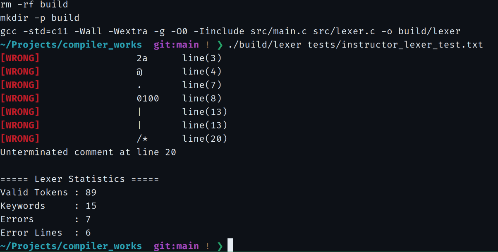
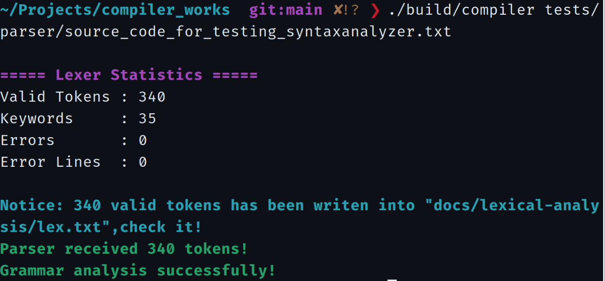

# Compiler Works

基于 **C11** 的编译原理课程实验项目，面向教学用途的简化类 C 语言，实现从词法识别、递归下降语法分析到语义检查和四元式生成的处理流程。

实验一和实验二已完成阶段验收。实验三已实现语义检查和四元式生成，待验收。

[快速开始](#快速开始) · [实验成果](#实验成果) · [实现架构](#实现架构) · [设计文档](#设计文档)

## 实验进度

| 实验 | 核心内容 | 状态 | 详细资料 |
| --- | --- | --- | --- |
| **01 · 词法分析** | Token 识别、注释处理、错误定位、自动机设计 | **已完成** | [实验说明](docs/lexical-analysis/README.md) · [验收报告](docs/lexical-analysis/results/README.md) |
| **02 · 语法分析** | 文法改造、FIRST/FOLLOW、递归下降、错误日志 | **已完成** | [实验说明](docs/syntax-analysis/README.md) · [验收报告](docs/syntax-analysis/results/README.md) |
| **03 · 语义分析** | 声明和初始化检查、双遍解析、四元式及控制流 | 已实现，待验收 | [实验说明](docs/semantic-analysis/README.md) · [验收样例](docs/semantic-analysis/results/example.c) · [四元式快照](docs/semantic-analysis/results/example-ir.txt) |

## 实验成果

| 实验一 · 词法分析 | 实验二 · 语法分析 |
| --- | --- |
| [](docs/lexical-analysis/results/screenshots/01-errors-and-statistics.png) | [](docs/syntax-analysis/results/screenshots/17-syntax-success.png) |
| **89** 个合法 Token，**15** 个关键字；检出 **7** 个词法错误，涉及 **6** 行。 | 归档 **16** 条首错报告（**15** 个不同错误行号）；修正后的测试版本以 **340** 个合法 Token 通过语法分析。 |
| [七张验收截图及 Token 快照](docs/lexical-analysis/results/README.md) | [17 张实测截图及错误日志快照](docs/syntax-analysis/results/README.md) |

> 实验二采用“遇到首个语法错误即停止”的策略。教师原始测试文件包含故意设置的错误；最终成功截图来自**逐轮修正后的版本**，并非原始文件直接通过。

## 实现架构

```text
源程序
  │
  ▼
Lexer（src/lexer.c）
  ├── 识别 Token、跳过注释、统计词法错误
  ├── 输出合法 Token → docs/lexical-analysis/lex.txt
  └── 合法 Token → TokenBuffer
                       │
             词法错误数为 0
                       ▼
             Parser · PARSE_CHECK
               ├── 递归下降、符号表构建和初始化检查
               ├── 首个语法错误 → 追加错误日志
               └── 语法和语义均通过
                       ▼
             Parser · PARSE_IR
               ├── 复用 TokenBuffer 和符号表
               └── 生成并验证四元式 → 终端与结果文件
```

- **Lexer**：关键字、标识符、无符号整数、运算符、分界符及两种注释；支持 `--all-tokens` 彩色输出。
- **Parser**：基于改造后的 22 组非终结符产生式，分析声明、赋值、输入输出、条件与循环语句。
- **四元式输出**支持算术、赋值、读写、关系比较、`if/else`、`while` 和 `for`。输出文件为 `docs/semantic-analysis/results/quadruples.txt`。
- **错误策略**按词法、语法、语义和 IR 阶段报告。语法分析首错停止，失败的 IR 生成保留上一次成功的结果文件。

## 快速开始

**环境：** Linux、GCC（C11）、GNU Make。从仓库根目录执行：

```bash
# 编译并运行回归测试
make all test

# 实验一：教师词法测试源程序
./build/compiler tests/lexer/source_code_for_testing_lexicalanalyzer.txt

# 实验二：合法与非法样例
./build/compiler tests/parser/valid.c
./build/compiler tests/parser/invalid.c

# 实验三：完整控制流样例与四元式
./build/compiler docs/semantic-analysis/results/example.c --all-tokens
cat docs/semantic-analysis/results/quadruples.txt

# 查看语法错误累计记录
cat docs/syntax-analysis/results/syntax-errors.txt
```

使用 `--all-tokens` 可输出完整彩色 Token 流。运行教师语法测试源程序：

```bash
./build/compiler tests/parser/source_code_for_testing_syntaxanalyzer.txt
```

该文件是**带有故意设置语法错误的原始样例**，运行结果应是首错报告，而非成功提示。连续记录错误时直接重复运行程序；`make clean` 会删除构建目录和运行时追加日志，请勿在需要累积错误的测试之间执行。

## 仓库结构

```text
.
├── src/                     # Lexer、Parser、语义分析、IR 和命令行入口
├── include/                 # 模块接口与公共定义
├── tests/
│   ├── lexer/               # 词法测试数据
│   ├── parser/              # 语法测试数据
│   ├── semantic/            # 语义检查与初始化状态回归
│   └── ir/                  # 四元式、控制流及命令行测试
├── docs/
│   ├── lexical-analysis/    # 实验一：理论、自动机图、测试报告
│   ├── syntax-analysis/     # 实验二：文法、FIRST/FOLLOW、测试截图
│   └── semantic-analysis/   # 实验三：语义分析、四元式及验收样例
├── Makefile
└── .gitignore
```

## 设计文档

| 资料 | 主要内容 |
| --- | --- |
| [课程实验文档索引](docs/README.md) | 三项实验资料导航 |
| [词法分析设计](docs/lexical-analysis/README.md) | Token 规则、NFA/DFA、实现方式 |
| [词法验收结果](docs/lexical-analysis/results/README.md) | 统计、错误明细、七张实测截图 |
| [语法分析设计](docs/syntax-analysis/README.md) | 递归下降、语法规则、日志处理 |
| [语法验收结果](docs/syntax-analysis/results/README.md) | 指定样例分轮测试、17 张实测截图 |
| [语法文法](docs/syntax-analysis/theory/grammar-specification.md) · [FIRST/FOLLOW](docs/syntax-analysis/theory/first-follow-sets.md) | 文法改造与预测分析理论 |
| [语义分析与四元式](docs/semantic-analysis/README.md) | 双遍解析、控制流布局、错误处理及测试结果 |

项目实现课程指导书定义的简化类 C 语言，处理流程止于四元式。自动机图用于词法理论分析，实际 Lexer 采用手写扫描。
