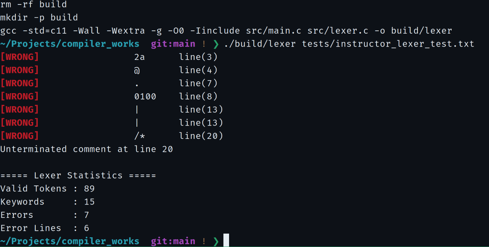
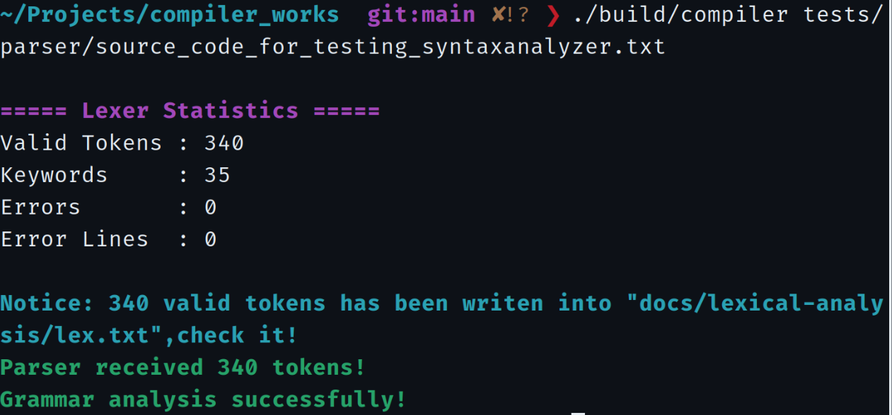

# Compiler Works

基于 **C11** 的编译原理课程实验项目，面向教学用途的简化类 C 语言，实现从源程序词法识别到递归下降语法分析的完整处理流程。

**项目进度：实验一（词法分析）与实验二（语法分析）已实现并完成阶段验收；语义分析与中间代码生成尚未实现。**

[快速开始](#快速开始) · [实验成果](#实验成果) · [实现架构](#实现架构) · [设计文档](#设计文档)

## 实验进度

| 实验 | 核心内容 | 状态 | 详细资料 |
| --- | --- | --- | --- |
| **01 · 词法分析** | Token 识别、注释处理、错误定位、自动机设计 | **已完成** | [实验说明](docs/lexical-analysis/README.md) · [验收报告](docs/lexical-analysis/results/README.md) |
| **02 · 语法分析** | 文法改造、FIRST/FOLLOW、递归下降、错误日志 | **已完成** | [实验说明](docs/syntax-analysis/README.md) · [验收报告](docs/syntax-analysis/results/README.md) |
| 03 · 语义分析 | 语义检查与中间代码生成 | 尚未实现 | — |

## 实验成果

| 实验一 · 词法分析 | 实验二 · 语法分析 |
| --- | --- |
| [](docs/lexical-analysis/results/screenshots/01-errors-and-statistics.png) | [](docs/syntax-analysis/results/screenshots/17-syntax-success.png) |
| **89** 个合法 Token，**15** 个关键字；检出 **7** 个词法错误，涉及 **6** 行。 | 归档 **16** 条首错报告（**15** 个不同错误行号）；修正后的测试版本以 **340** 个合法 Token 通过语法分析。 |
| [七张验收截图及 Token 快照](docs/lexical-analysis/results/README.md) | [17 张实测截图及错误日志快照](docs/syntax-analysis/results/README.md) |

> 实验二采用“遇到首个语法错误即停止”的策略。教师原始测试文件包含故意设置的错误；最终成功截图来自**逐轮修正后的版本**，并非原始文件直接通过。

## 实现架构

```text
源程序
  │
  ▼
Lexer（src/lexer.c）
  ├── 识别 Token、跳过注释、统计词法错误
  ├── 输出合法 Token → docs/lexical-analysis/lex.txt
  └── 合法 Token → TokenBuffer
                       │
             词法错误数为 0
                       ▼
             Parser（src/parser.c）
               ├── 文法预测与递归下降
               ├── 声明、语句与表达式分析
               └── 语法错误定位 → 追加错误日志
```

- **Lexer**：关键字、标识符、无符号整数、运算符、分界符及两种注释；支持 `--all-tokens` 彩色输出。
- **Parser**：基于改造后的 22 组非终结符产生式，分析声明、赋值、输入输出、条件与循环语句。
- **错误策略**：词法检查未通过则跳过 Parser；语法分析首错停止，每次运行最多追加一条语法错误记录。

## 快速开始

**环境：** Linux、GCC（C11）、GNU Make。从仓库根目录执行：

```bash
# 编译
make

# 实验一：教师词法测试源程序
./build/compiler tests/lexer/source_code_for_testing_lexicalanalyzer.txt

# 实验二：合法与非法样例
./build/compiler tests/parser/valid.c
./build/compiler tests/parser/invalid.c

# 查看语法错误累计记录
cat docs/syntax-analysis/results/syntax-errors.txt
```

使用 `--all-tokens` 可输出完整彩色 Token 流。运行教师语法测试源程序：

```bash
./build/compiler tests/parser/source_code_for_testing_syntaxanalyzer.txt
```

该文件是**带有故意设置语法错误的原始样例**，运行结果应是首错报告，而非成功提示。连续记录错误时直接重复运行程序；`make clean` 会删除构建目录和运行时追加日志，请勿在需要累积错误的测试之间执行。

## 仓库结构

```text
.
├── src/                     # main.c / lexer.c / parser.c
├── include/                 # Lexer、Parser 与公共定义
├── tests/
│   ├── lexer/               # 词法测试数据
│   └── parser/              # 语法测试数据
├── docs/
│   ├── lexical-analysis/    # 实验一：理论、自动机图、测试报告
│   └── syntax-analysis/     # 实验二：文法、FIRST/FOLLOW、测试截图
├── Makefile
└── .gitignore
```

## 设计文档

| 资料 | 主要内容 |
| --- | --- |
| [课程实验文档索引](docs/README.md) | 两项实验资料导航 |
| [词法分析设计](docs/lexical-analysis/README.md) | Token 规则、NFA/DFA、实现方式 |
| [词法验收结果](docs/lexical-analysis/results/README.md) | 统计、错误明细、七张实测截图 |
| [语法分析设计](docs/syntax-analysis/README.md) | 递归下降、语法规则、日志处理 |
| [语法验收结果](docs/syntax-analysis/results/README.md) | 指定样例分轮测试、17 张实测截图 |
| [语法文法](docs/syntax-analysis/theory/grammar-specification.md) · [FIRST/FOLLOW](docs/syntax-analysis/theory/first-follow-sets.md) | 文法改造与预测分析理论 |

**范围说明：** 本项目实现课程指导书定义的简化类 C 语言，**不是完整的 C 编译器**。自动机图用于词法理论分析，实际 Lexer 采用手写扫描；实验三尚未开发。
