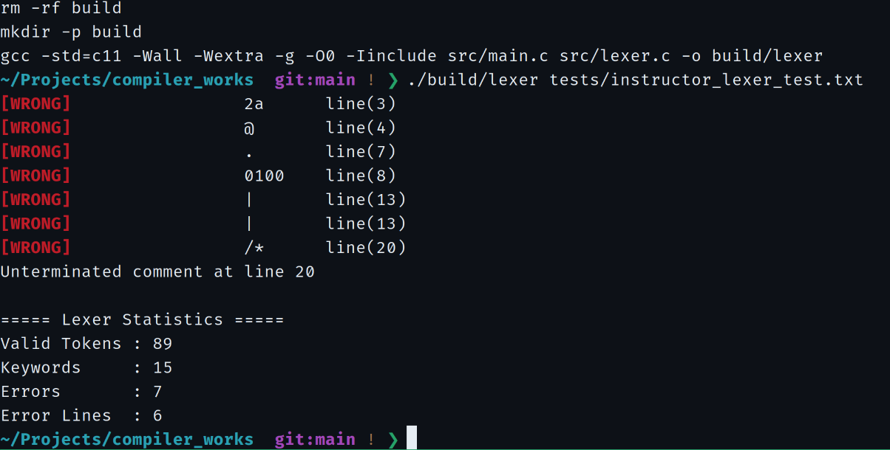

# 课程实验文档 · Compiler Works

本目录集中展示编译器课程实验的设计依据、自动机模型、推导过程与实测结果。源代码位于仓库 `src/`，测试输入位于 `tests/`。

## 实验目录

| 阶段 | 实验内容 | 成果 |
| --- | --- | --- |
| **[实验一 · 词法分析](lexical-analysis/README.md)** | 正则规则、七类 NFA、合并 NFA、DFA 确定化与最小化、C11 Lexer | **已完成指定样例验收** |
| **[实验二 · 语法分析](grammar-analysis/README.md)** | 文法改造、FIRST/FOLLOW、递归下降与错误记录 | **功能实现，基础回归通过** |
| 实验三 · 语义分析与翻译 | 语义处理与中间代码生成 | 后续开发 |

## 实验一成果导航

| 分类 | 内容 |
| --- | --- |
| [词法分析总览](lexical-analysis/README.md) | 系统结构、支持的词法规则、运行命令与实验结论 |
| [理论推导](lexical-analysis/theory/nfa-to-dfa.md) | 子集构造与 DFA 状态转换；另见 [最小化](lexical-analysis/theory/dfa-minimization.md) |
| [自动机图](lexical-analysis/README.md#十张自动机图) | 7 张规则 NFA、合并 NFA、确定化 DFA 与最小化 DFA，共 10 张 |
| [验收报告](lexical-analysis/results/README.md) | 完整错误表、89 个 Token 的统计及 7 张终端截图 |
| [合法 Token 输出快照](lexical-analysis/results/instructor-lex.txt) | 指定源程序产生的 89 条合法 Token（另含表头） |

### 指定样例验收摘要

| Valid Tokens | Keywords | Errors | Error Lines | lex.txt |
| ---: | ---: | ---: | ---: | ---: |
| **89** | **15** | **7** | **6** | **90 行** |

## 实验二成果导航

| 分类 | 内容 |
| --- | --- |
| [语法分析总览](grammar-analysis/README.md) | 文法改造、接口与当前进度 |
| [改造后的语法文法](grammar-analysis/theory/grammar-specification.md) | 22 组产生式与文法改造说明 |
| [FIRST 与 FOLLOW 集](grammar-analysis/theory/first-follow-sets.md) | 预测分析集合与 LL(1) 冲突检查 |
| [实验二测试记录](grammar-analysis/results/README.md) | 合法/非法输入、错误日志追加及清理测试 |

## 文件组织

- `lexical-analysis/figures/`：10 张已归档的自动机设计图。
- `lexical-analysis/theory/`：四份可在线阅读的数学推导和算法说明。
- `lexical-analysis/results/`：正式验收报告、输出快照、实际终端截图。
- `lexical-analysis/lex.txt`：运行时生成的合法 Token 文件，由 Git 忽略；正式输出快照已归档。
- `grammar-analysis/theory/`：文法定义、FIRST / FOLLOW 集及理论说明。
- `grammar-analysis/results/`：测试记录；`grammar-errors.txt` 为运行时生成的追加日志，由 Git 忽略。

[返回项目主页](../README.md)
