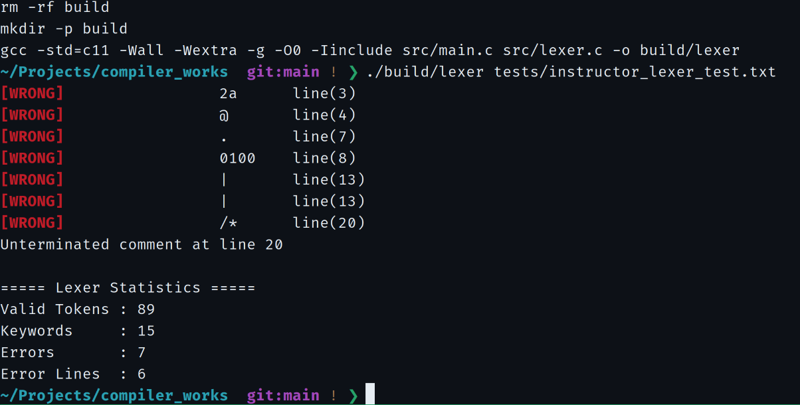

# 实验一 · 词法分析

基于 C11 的手写词法分析器，将简化类 C 语言源程序转换为 Token 序列，并完成错误定位、数量统计及文件输出。实验设计同时包含 NFA、DFA 构造与最小化推导。

## 词法规则与功能

| 模块 | 规则或行为 |
| --- | --- |
| 关键字 | `if`、`else`、`for`、`while`、`int`、`write`、`read` |
| 标识符 | 字母开头，后续为字母或数字 |
| 无符号整数 | `0` 或非零数字开头的十进制整数；不接受前导零 |
| 运算符 | `+` `-` `*` `/` `=` `<` `>` `>=` `<=` `!=` `==` |
| 分界符 | `,` `(` `)` `;` `{` `}` |
| 注释 | 单行 `//`、块注释 `/*...*/`，识别后跳过 |
| 错误处理 | 非法数字词素、未知字符、无效运算符、超长词素、未闭合块注释 |
| 输出 | 终端统计、可选彩色 Token 流、合法 Token 文件及 `TokenBuffer` |

## 实现方法

```text
lexer_scan_file()
  ├── 字符读取与分类（fgetc / ungetc）
  ├── 标识符、数字、分界符及运算符识别
  ├── 单行 / 多行注释跳过
  └── emit_token()
        ├── 更新 LexerState
        ├── 输出终端信息
        ├── 保存合法 Token → lex.txt
        └── 写入 TokenBuffer → Parser
```

词法识别由 `src/lexer.c` 负责。理论文档中的有限自动机是规则建模成果，并非程序运行时使用的 DFA 状态表。

## 编译与测试

从仓库根目录执行：

```bash
make

# 运行指定词法测试程序
./build/compiler tests/lexer/source_code_for_testing_lexicalanalyzer.txt

# 显示全部彩色 Token
./build/compiler tests/lexer/source_code_for_testing_lexicalanalyzer.txt --all-tokens

# 查看合法 Token 输出
cat docs/lexical-analysis/lex.txt
```

默认模式输出词法错误及统计信息；`--all-tokens` 展示完整 Token 流。输出文件包含表头，只写入合法 Token。

## 验收结果

| 合法 Token | 关键字 | 词法错误 | 错误行数 | Token 输出文件 |
| ---: | ---: | ---: | ---: | ---: |
| **89** | **15** | **7** | **6** | **90 行（含表头）** |

[](results/screenshots/01-errors-and-statistics.png)

错误分别发生于第 3、4、7、8、13（两处）、20 行。测试结果、原始终端截图和完整 Token 快照见[实验一验收报告](results/README.md)。

## 理论设计

| 文档 | 内容 |
| --- | --- |
| [词法规则与 Token](theory/regex-and-tokens.md) | 规则定义和分类优先级 |
| [NFA → DFA](theory/nfa-to-dfa.md) | 合并 NFA、子集构造及 38 状态 DFA |
| [DFA 最小化](theory/dfa-minimization.md) | 状态等价划分与 30 状态 DFA |
| [最长匹配与错误处理](theory/maximal-munch.md) | 向前看、回退和词法错误聚合 |

### 自动机图（10 张）

| 阶段 | 图示 |
| --- | --- |
| 基础规则 NFA | [标识符](figures/Identifier-NFA.png) · [关键字](figures/Keyword-NFA.png) · [整数](figures/Number-NFA.png) · [分界符](figures/Delimiter-NFA.png) · [运算符](figures/Operator-NFA.png) |
| 注释 NFA | [单行注释](figures/Single_line_comment-NFA.png) · [多行注释](figures/Block_comment-NFA.png) |
| 合并 NFA | [七类规则合并](figures/Seven_lexical_analysis_sum-NFA.png) |
| 完整 DFA | [确定化结果](figures/Full-DFA.png) |
| 最小化 DFA | [最终自动机](figures/Min-DFA.png) |

**语言范围：** Lexer 按课程规定处理简化词法规则，不承担完整 C 语言的词法解析或语法正确性判定。

[实验一测试报告](results/README.md) · [实验二语法分析](../syntax-analysis/README.md) · [文档索引](../README.md)
