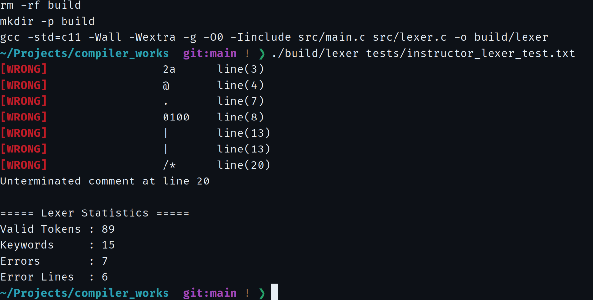
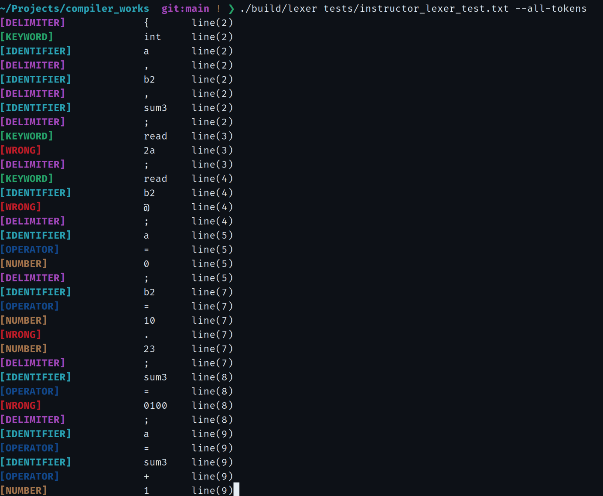

# 实验一 · 词法分析验收结果

**验收日期：2026-10-29**  
**程序：C11 词法分析器（`src/main.c`、`src/lexer.c`）**  
**测试输入：[instructor_lexer_test.txt](../../../tests/instructor_lexer_test.txt)**  
**运行环境：Ubuntu / GCC / GNU Make**

本次使用指导样例完成词法识别、错误定位、注释处理、运算符最长匹配和纯文本 Token 输出验证，**测试结果与既定词法规则一致**。

## 验收结果

| 指标 | 实测 | 预期 | 结果 |
| --- | ---: | ---: | --- |
| 合法 Token | **89** | 89 | 一致 |
| 关键字 | **15** | 15 | 一致 |
| 词法错误 | **7** | 7 | 一致 |
| 错误行数 | **6** | 6 | 一致 |
| `docs/lex.txt` 行数 | **90** | 90（含 1 行表头） | 一致 |

### 默认模式 · 错误输出与统计

```bash
make clean && make
./build/lexer tests/instructor_lexer_test.txt
```

[](screenshots/01-errors-and-statistics.png)

## 词法错误清单

| 源码行号 | 词素 | 检测结果 |
| ---: | --- | --- |
| 3 | `2a` | 数字开头的非法字母数字串 |
| 4 | `@` | 未定义字符 |
| 7 | `.` | 本实验不支持浮点数词法 |
| 8 | `0100` | 非法前导零整数 |
| 13 | &#124; | 第一个不支持的竖线字符 |
| 13 | &#124; | 第二个不支持的竖线字符 |
| 20 | `/*` | 块注释未闭合（EOF） |

出错行集合：**3、4、7、8、13、20**。第 13 行有两个错误，所以错误总数为 7、错误行数为 6。

## 完整 Token 彩色输出

```bash
./build/lexer tests/instructor_lexer_test.txt --all-tokens
```

七张原始截图已按运行阶段归档，点击文件即可查看原图：

| 阶段 | 截图 |
| --- | --- |
| 默认错误报告及统计 | [01 · errors-and-statistics](screenshots/01-errors-and-statistics.png) |
| 全部 Token，开始部分 | [02 · all-tokens-start](screenshots/02-all-tokens-start.png) |
| 全部 Token，中段（一） | [03 · all-tokens-middle-a](screenshots/03-all-tokens-middle-a.png) |
| 全部 Token，中段（二） | [04 · all-tokens-middle-b](screenshots/04-all-tokens-middle-b.png) |
| 全部 Token，结束及统计 | [05 · all-tokens-end](screenshots/05-all-tokens-end.png) |
| `lex.txt`，开头部分 | [06 · lex-output-first](screenshots/06-lex-output-first.png) |
| `lex.txt`，末尾部分 | [07 · lex-output-last](screenshots/07-lex-output-last.png) |

[](screenshots/02-all-tokens-start.png)

## 合法 Token 输出文件

```bash
wc -l docs/lex.txt
# 90 docs/lex.txt
```

[**查看完整合法 Token 快照：instructor-lex.txt**](instructor-lex.txt)

输出快照包含 1 行表头和 **89 条合法 Token**，字段为类型、词素、源码行号，**不含 WRONG Token 与终端 ANSI 颜色控制字符**。

## 结果分析

- **数字与非法词素**：`2a`、`0100` 被判为错误；`10.23` 则输出 `10`、错误 `.`、`23`，符合当前不支持浮点数的词法设计。
- **运算符**：`>=`、`==`、`!=` 被识别为双字符运算符；`||` 作为两个不支持的 `|` 字符报错。
- **注释**：单行注释与闭合的多行注释被跳过；未闭合的 `/*` 在 EOF 报告起始行号为 20。
- **统计与文件**：合法 Token 及关键字数、错误数、错误行数与输出文件行数互相吻合。

## 验收结论

**实验一的指定样例验收通过。** 本次结果证明程序在提供的样例中正确实现了词法分类、词法错误检测及定位、注释处理、最长匹配和合法 Token 文件输出。实验源码、十张自动机图、四份理论推导、指定测试输入、输出快照及七张终端实测截图均已归档。

[返回实验一](../README.md) · [返回仓库主页](../../../README.md)
