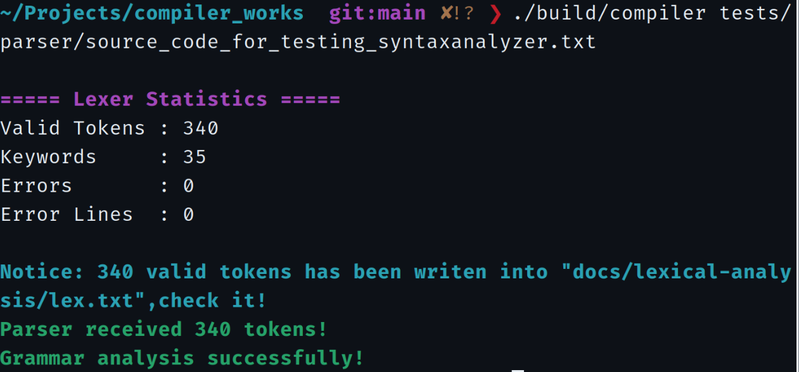

# 实验二 · 递归下降语法分析

在 Lexer 输出的合法 Token 序列上，依据改造后的简化类 C 语言文法进行递归下降语法分析。程序检查声明、表达式和语句结构，并在发现第一处语法错误时停止。

## 语法分析功能

| 模块 | 实现内容 |
| --- | --- |
| 文法处理 | 消除左递归、提取左公因子；计算 FIRST/FOLLOW 集并检查 LL(1) 条件 |
| Parser 输入 | Lexer 输出的 `TokenBuffer`；存在词法错误时跳过语法分析 |
| 表达式 | 因子、乘除项、加减表达式、关系运算表达式 |
| 语句 | 声明、赋值、`read/write`、`if-else`、`while`、`for`、复合语句 |
| 错误处理 | 首错停止，记录行号与期望/实际词素 |
| 错误归档 | 追加写入日志，`make clean` 可清除累计运行记录 |

### 分析流程

```text
parser_program()
  ├── 匹配 {
  ├── declaration_list()   # 声明序列
  ├── statement_list()     # 语句序列
  │     └── statement()    # 根据 Token 选择具体语句规则
  ├── 匹配 }
  └── 确认输入结束
```

改造后的文法包含 **22 组非终结符产生式、44 个候选式**。其中悬挂 `else` 不满足严格 LL(1) 的无冲突条件，分析器采用 `else` 与最近未匹配 `if` 结合的约定。

## 构建与运行

```bash
make

# 合法程序：预期语法检查通过
./build/compiler tests/parser/valid.c

# 非法表达式：预期报告第 3 行的语法错误
./build/compiler tests/parser/invalid.c

# 教师测试源程序：保留原始语法错误
./build/compiler tests/parser/source_code_for_testing_syntaxanalyzer.txt
```

默认行为是**遇到第一处语法错误立即返回**。因此，同一原始带错文件不能在单次执行中输出全部潜在错误；逐轮修正后重新运行才能推进检查位置。

## 验收结果

| 测试指标 | 归档结果 |
| --- | ---: |
| 逐轮测试中保存的首错记录 | **16 条** |
| 不重复的错误行号 | **15 行** |
| 实际终端截图 | **17 张（16 张错误、1 张最终通过）** |
| 最终修正版本合法 Token | **340** |
| 最终修正版本关键字 | **35** |
| 最终语法分析 | **通过** |

[](results/screenshots/17-syntax-success.png)

以上最终结果来自修正后的测试版本；原始教师源文件保留故意设置的语法错误。完整明细、测试过程和图片证据见[实验二验收报告](results/README.md)。

## 运行时错误日志

```bash
# 查看累计错误
cat docs/syntax-analysis/results/syntax-errors.txt
wc -l docs/syntax-analysis/results/syntax-errors.txt

# 重置运行日志和构建产物
make clean
```

- **追加日志**：`results/syntax-errors.txt`，每次运行发现语法错误时写入一条 `源文件:行号:错误描述`。
- **正式快照**：[syntax-errors-snapshot.txt](results/syntax-errors-snapshot.txt)，保存验收期间实际记录的 16 条首错报告。
- **统计口径**：一条日志表示一次运行发现的第一处语法错误，不等同于同一文件全部语法错误数。
- **Git 管理**：运行时日志被忽略，正式快照和 PNG 截图纳入仓库版本控制。

## 理论设计

| 文档 | 内容 |
| --- | --- |
| [改造后的文法](theory/grammar-specification.md) | 22 组语法规则、左递归和左因子处理 |
| [FIRST/FOLLOW 与 LL(1) 检查](theory/first-follow-sets.md) | 44 个候选式的 FIRST 集与 FOLLOW 集 |
| [理论文档索引](theory/README.md) | 文法分析资料导航 |

[实验二验收报告](results/README.md) · [截图索引](results/screenshots-manifest.md) · [文档索引](../README.md)
