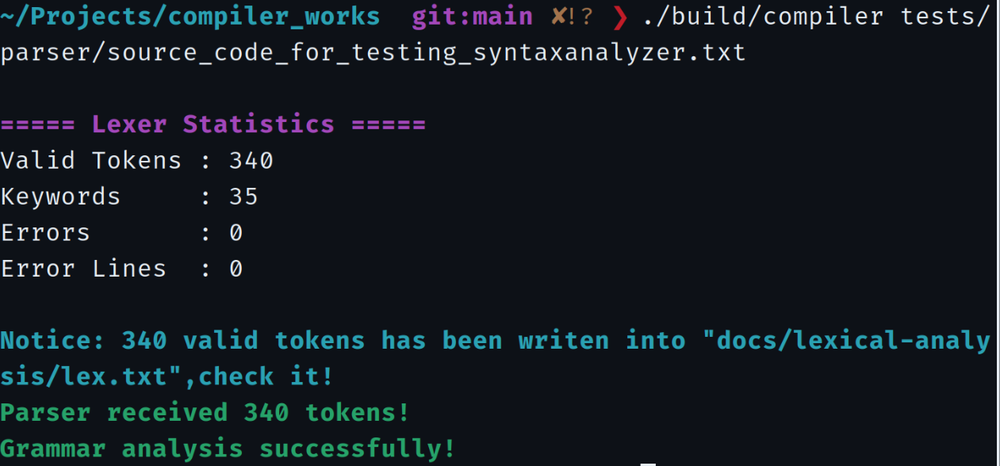

# 实验二 · 语法分析验收记录

**实验环境：** Linux / GCC / GNU Make（C11）  
**指定输入：** [教师测试源程序](../../../tests/parser/source_code_for_testing_syntaxanalyzer.txt)  
**分析策略：** 递归下降；发现首个语法错误后停止分析

本次实验以含有故意设置语法错误的源文件为输入，通过“运行—定位—修正—再次运行”的方式分阶段验证分析器。原始测试文件已单独保留；各轮修正版本的终端证据按测试顺序归档。

## 主要结果

| 指标 | 结果 |
| --- | ---: |
| 已归档错误报告 | **16 条** |
| 不重复的错误行号 | **15 行** |
| 归档终端截图 | **17 张（16 张错误、1 张最终通过）** |
| 最终通过时合法 Token | **340** |
| 最终通过时关键字 | **35** |
| 最终通过时词法错误 / 错误行 | **0 / 0** |
| 最终语法分析 | **成功** |

## 语法错误检测记录

下表对应[已保存的 16 条错误日志](syntax-errors-snapshot.txt)。错误行号采用源文件中的行号，表格中的描述用于分类；实际程序输出记录了具体的期望与当前词素。

| 序号 | 行号 | 期望 Token | 实际 Token | 错误说明 |
| ---: | ---: | --- | --- | --- |
| 1 | 04 | `identifier` | `;` | 声明列表中的逗号后缺少标识符 |
| 2 | 05 | `;` | `d3` | 声明末尾缺少分号 |
| 3 | 43 | `identifier` | `;` | for 初始化部分缺少赋值左值 |
| 4 | 45 | `=` | `;` | for 初始化表达式缺少赋值符号 |
| 5 | 47 | `;` | `)` | for 初始化表达式后缺少分号 |
| 6 | 48 | `;` | `)` | for 条件表达式后缺少分号 |
| 7 | 49 | `)` | `;` | for 头部多余分号 |
| 8 | 50 | `(` | `a` | while 缺少左括号 |
| 9 | 51 | `)` | `;` | while 条件缺少右括号 |
| 10 | 52 | `(` | `a` | if 缺少左括号 |
| 11 | 53 | `)` | `;` | if 条件缺少右括号 |
| 12 | 60 | `;` | `<` | write 算术表达式后出现关系运算符 |
| 13 | 61 | `identifier` | `;` | read 缺少标识符 |
| 14 | 62 | `;` | `write` | read 语句后缺少分号 |
| 15 | 62 | `;` | `write` | 对同一处错误重复执行 |
| 16 | 63 | `statement` | `else` | 未匹配的 else |

第 62 行出现两条相同记录，是同一错误经过两次运行得到的结果，**不是两个不同的语法错误**。第 54–59 行等部分中间错误经过人工修正，没有保留逐项运行截图。因此 16 条记录仅表示本次已归档的运行结果，不能作为原文件全部潜在错误的严格计数。

## 最终通过验证

对测试源程序的错误逐步修正后，最后一轮终端显示：

```text
===== Lexer Statistics =====
Valid Tokens : 340
Keywords     : 35
Errors       : 0
Error Lines  : 0

Parser received 340 tokens!
Grammar analysis successfully!
```

以上为**修正后版本**的终端实测结果；保留在 `tests/parser/` 的原始测试源程序仍包含语法错误。

## 日志管理与复现

```bash
make clean && make

# 原始测试文件：定位第一处错误并追加一条日志
./build/compiler tests/parser/source_code_for_testing_syntaxanalyzer.txt

# 查看累计结果
cat docs/syntax-analysis/results/syntax-errors.txt
wc -l docs/syntax-analysis/results/syntax-errors.txt

# 清空运行时日志与构建产物
make clean
```

程序以追加模式打开 `syntax-errors.txt`，因此跨多次执行的错误会累积。运行时日志由 Git 忽略，正式验收记录保存在 [syntax-errors-snapshot.txt](syntax-errors-snapshot.txt)。执行 `make clean` 不会删除已归档快照和本 README。

## 截图资料

17 张终端截图已按原始 PNG 文件上传至 [screenshots/](screenshots/)，其中包含 16 次语法错误报告与 1 次最终通过。逐张文件名、源程序行号及测试阶段参见 [终端截图索引](screenshots-manifest.md)。

[](screenshots/17-syntax-success.png)

[返回实验二](../README.md) · [返回文档首页](../../README.md)
