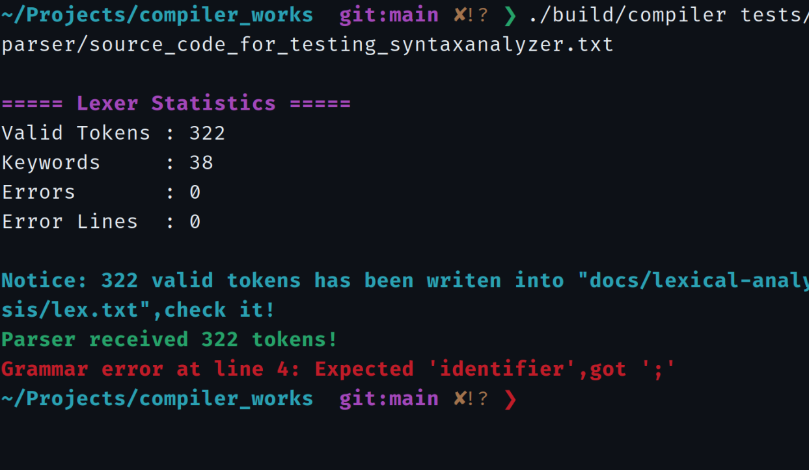
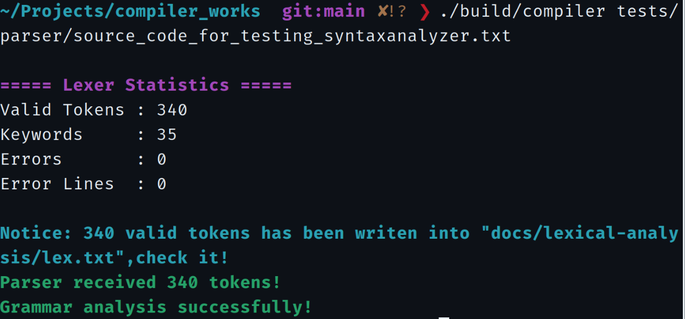

# 实验二 · 终端截图索引

本次实验归档 17 张原始 PNG，按运行时间依次编号，包括 16 次错误报告和 1 次最终通过。截图已按原始文件字节上传至本仓库，可点击文件名查看完整 PNG。

| 编号 | 行号 | 运行结果 | 归档图片 |
| ---: | ---: | --- | --- |
| 01 | 04 | 声明缺少标识符 | [01-04-identifier-expected.png](screenshots/01-04-identifier-expected.png) |
| 02 | 05 | 声明缺少分号 | [02-05-semicolon-expected.png](screenshots/02-05-semicolon-expected.png) |
| 03 | 43 | for 初始化项缺少标识符 | [03-43-identifier-expected.png](screenshots/03-43-identifier-expected.png) |
| 04 | 45 | for 初始化项缺少赋值符 | [04-45-assignment-expected.png](screenshots/04-45-assignment-expected.png) |
| 05 | 47 | for 头部缺少分号 | [05-47-for-semicolon.png](screenshots/05-47-for-semicolon.png) |
| 06 | 48 | for 头部缺少分号 | [06-48-for-semicolon.png](screenshots/06-48-for-semicolon.png) |
| 07 | 49 | for 头部缺少右括号 | [07-49-for-right-parenthesis.png](screenshots/07-49-for-right-parenthesis.png) |
| 08 | 50 | while 缺少左括号 | [08-50-while-left-parenthesis.png](screenshots/08-50-while-left-parenthesis.png) |
| 09 | 51 | while 缺少右括号 | [09-51-while-right-parenthesis.png](screenshots/09-51-while-right-parenthesis.png) |
| 10 | 52 | if 缺少左括号 | [10-52-if-left-parenthesis.png](screenshots/10-52-if-left-parenthesis.png) |
| 11 | 53 | if 缺少右括号 | [11-53-if-right-parenthesis.png](screenshots/11-53-if-right-parenthesis.png) |
| 12 | 60 | write 后存在不符合文法的关系比较 | [12-60-write-semicolon.png](screenshots/12-60-write-semicolon.png) |
| 13 | 61 | read 缺少标识符 | [13-61-read-identifier.png](screenshots/13-61-read-identifier.png) |
| 14 | 62 | read 后缺少分号（首次） | [14-62-missing-semicolon-a.png](screenshots/14-62-missing-semicolon-a.png) |
| 15 | 62 | read 后缺少分号（重复） | [15-62-missing-semicolon-b.png](screenshots/15-62-missing-semicolon-b.png) |
| 16 | 63 | 单独出现 else | [16-63-unexpected-else.png](screenshots/16-63-unexpected-else.png) |
| 17 | — | 修复版本语法分析成功 | [17-syntax-success.png](screenshots/17-syntax-success.png) |

## 典型截图

**首处语法错误（第 4 行）：**

**最终语法分析成功：**

截图来自逐轮修改后的不同输入版本。原始测试源文件保存在 `tests/parser/source_code_for_testing_syntaxanalyzer.txt`，不应将最终通过截图理解为原始未修正文件直接通过分析。

[返回测试记录](README.md) · [返回实验二](../README.md)
